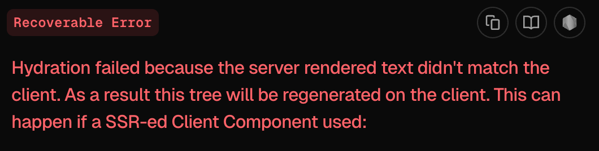
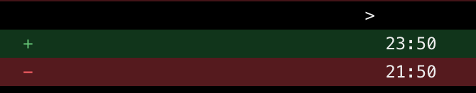
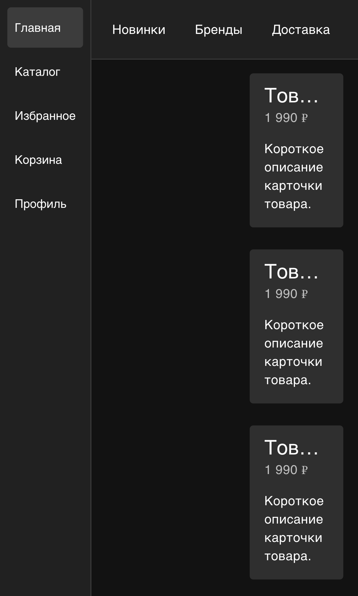
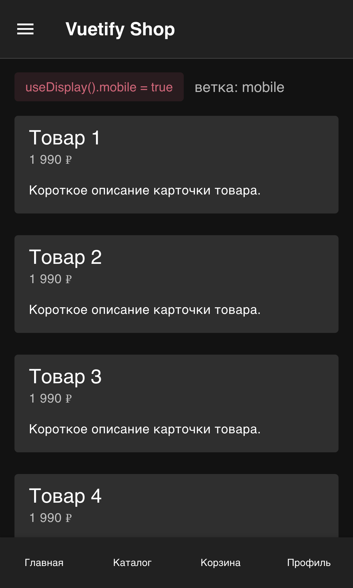
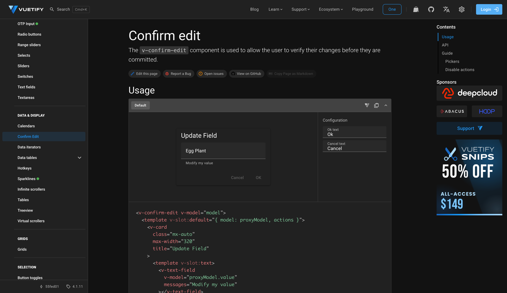
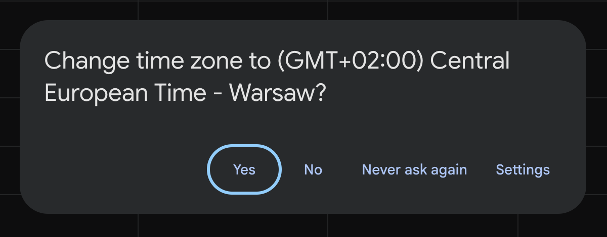

# Первый блин комом

## SSR-рендер вслепую
---
src: ./snippets/who.md
---
---
layout: statement
---

# И я фанат тёмной темы
---
layout: hero
---

<div class="h-full flex items-center justify-center">

{width=460px style="animation: none;"}
</div>
---
layout: section
prefix: Цель (ожидание)
---

# Перестать ловить флешки
---
layout: section
prefix: Цель (реальность)
---

# Перестать угадывать устройство
---
layout: section
prefix: Акт 01
---

# А почему не угадывать?
---
layout: hero
---

<div class="h-full flex flex-col items-center justify-center gap-[var(--s-4)]">

  <SlidevVideo
    autoplay
    autoreset="slide"
    loop
    muted
    playsinline
    class="rounded-[var(--r-lg)] border border-border max-h-[340px] w-auto"
    print-poster="/flash_nuxt_poster.png"
    @loadedmetadata="(e) => e.target.playbackRate = 0.4"
  >
    <source src="./assets/flash_nuxt.mp4" type="video/mp4" />
  </SlidevVideo>

  <div class="font-mono text-sm text-fg-dim">тёмная тема в системе · <span class="text-fg">страница приходит белой</span> · замедление 0.4×</div>

  <div class="flex items-center gap-[var(--s-3)] font-mono text-sm">
    <span class="chip"><span class="inline-block w-3 h-3 rounded-full bg-white"></span>hydrating · HTML с сервера</span>
    <carbon-arrow-right class="text-fg-dim" />
    <span class="chip"><span class="inline-block w-3 h-3 rounded-full bg-[#0b0b0f] border border-border-hi"></span>hydrated · клиент пересчитал</span>
  </div>

</div>
---
layout: hero
---

<div class="max-w-[720px] mx-auto w-full">

```ts {7}
// nuxt.config.ts
export default defineNuxtConfig({
  modules: ['vuetify-nuxt-module'],
  vuetify: {
    vuetifyOptions: {
      theme: {
        defaultTheme: 'system', // ← подхватить системную тему
      },
    },
  },
})
```

</div>
---
layout: default
---

::title::

Что произошло

::default::

<div class="h-full flex flex-col items-center justify-center gap-[var(--s-6)]">
  <div class="flex items-stretch gap-[var(--s-4)]">

  <div v-click class="card flex flex-col items-center justify-center gap-[var(--s-3)] w-[224px] text-center">
    <carbon-view-off class="text-[44px] text-danger" />
    <div class="text-[var(--t-h3)] font-bold">Сервер</div>
    <div class="text-fg-muted text-sm">не видит систему</div>
    <span class="code-pill">theme = light</span>
  </div>

  <div v-click class="flex items-center"><carbon-arrow-right class="text-[32px] text-fg-dim" /></div>

  <div v-after class="card flex flex-col items-center justify-center gap-[var(--s-3)] w-[224px] text-center">
    <carbon-document class="text-[44px] text-fg-muted" />
    <div class="text-[var(--t-h3)] font-bold">HTML</div>
    <div class="text-fg-muted text-sm">приходит как есть</div>
    <span class="code-pill">class="light"</span>
  </div>

  <div v-click class="flex items-center"><carbon-arrow-right class="text-[32px] text-fg-dim" /></div>

  <div v-after class="card flex flex-col items-center justify-center gap-[var(--s-3)] w-[224px] text-center">
    <carbon-view class="text-[44px] text-accent" />
    <div class="text-[var(--t-h3)] font-bold">Клиент</div>
    <div class="text-fg-muted text-sm">знает систему</div>
    <span class="code-pill text-danger">нужно dark</span>
  </div>

  </div>

  <div v-click class="rounded-[var(--r-md)] border border-danger bg-surface px-[var(--s-5)] py-[var(--s-3)] font-mono text-sm">
    <span class="text-fg-dim">сервер сказал</span> light <span class="text-danger mx-[var(--s-2)]">≠</span> dark <span class="text-fg-dim">хотел клиент</span>
  </div>
</div>
---
layout: statement
---

# Подозреваемый

## Дурацкий фреймворк

<div class="mt-[var(--s-6)] flex items-center gap-[var(--s-3)]">
  <span class="text-fg-dim text-sm">улики:</span>
  <span class="chip">vuetify/nuxt-module#325</span>
  <span class="chip">vuetify/nuxt-module#58</span>
</div>
---
layout: hero
---

<div class="h-full flex flex-col items-center justify-center gap-[var(--s-4)]">

  <SlidevVideo
    autoplay
    autoreset="slide"
    loop
    muted
    playsinline
    class="rounded-[var(--r-lg)] border border-border max-h-[340px] w-auto"
    print-poster="/flash_next_poster.png"
    @loadedmetadata="(e) => e.target.playbackRate = 0.4"
  >
    <source src="./assets/flash_next.mp4" type="video/mp4" />
  </SlidevVideo>

  <div class="font-mono text-sm text-fg-dim">Next.js + next-themes · <span class="text-fg">та же вспышка</span> · замедление 0.4×</div>

  <div class="flex items-center gap-[var(--s-3)] font-mono text-sm">
    <span class="chip"><span class="inline-block w-3 h-3 rounded-full bg-white"></span>hydrating · HTML с сервера</span>
    <carbon-arrow-right class="text-fg-dim" />
    <span class="chip"><span class="inline-block w-3 h-3 rounded-full bg-[#0b0b0f] border border-border-hi"></span>hydrated · клиент пересчитал</span>
  </div>

</div>
---
layout: hero
---

<div class="h-full flex flex-col items-center justify-center gap-[var(--s-4)]">

  <SlidevVideo
    autoplay
    autoreset="slide"
    loop
    muted
    playsinline
    class="rounded-[var(--r-lg)] border border-border max-h-[340px] w-auto"
    print-poster="/flash_sveltekit_poster.png"
    @loadedmetadata="(e) => e.target.playbackRate = 0.4"
  >
    <source src="./assets/flash_sveltekit.mp4" type="video/mp4" />
  </SlidevVideo>

  <div class="font-mono text-sm text-fg-dim">SvelteKit · <span class="text-fg">третий фреймворк, один симптом</span> · замедление 0.4×</div>

  <div class="flex items-center gap-[var(--s-3)] font-mono text-sm">
    <span class="chip"><span class="inline-block w-3 h-3 rounded-full bg-white"></span>hydrating · HTML с сервера</span>
    <carbon-arrow-right class="text-fg-dim" />
    <span class="chip"><span class="inline-block w-3 h-3 rounded-full bg-[#0b0b0f] border border-border-hi"></span>hydrated · клиент пересчитал</span>
  </div>

</div>
---
layout: statement
---

# Алиби

## Три фреймворка, один симптом

<div class="mt-[var(--s-6)] text-fg-muted text-[var(--t-h3)]">HTML готов раньше, чем известно устройство</div>
---
layout: hero
---

<div class="h-full flex flex-col justify-center gap-[var(--s-5)]">

  <div class="h-[80px]">
    <div class="text-[var(--t-h3)] font-bold">Прямой связи нет</div>
    <div class="text-fg-muted text-sm mt-[var(--s-1)]">Сервер рендерит по снимку состояния, клиент знает живое. Сказать серверу, что изменилось, нечем</div>
  </div>

  <div class="flex items-center gap-[var(--s-4)]">

  <div class="card flex flex-col items-center gap-[var(--s-3)] w-[280px] text-center py-[var(--s-6)]">
    <carbon-bare-metal-server class="text-[48px] text-fg-muted" />
    <div class="text-[var(--t-h2)] font-bold">Сервер</div>
    <span class="chip">HTML-снимок</span>
    <div class="text-fg-muted text-sm">рендерит по снимку состояния</div>
  </div>

  <div class="flex flex-col items-center gap-[var(--s-2)] w-[180px] text-center">
    <div class="font-mono text-sm uppercase tracking-[0.12em] text-fg-dim">нет прямой</div>
    <div class="w-full h-[64px] rounded-[var(--r-md)] border border-dashed border-border-hi"></div>
    <div class="font-mono text-sm uppercase tracking-[0.12em] text-fg-dim">связи</div>
  </div>

  <div class="card flex flex-col items-center gap-[var(--s-3)] w-[280px] text-center py-[var(--s-6)]">
    <carbon-laptop class="text-[48px] text-accent" />
    <div class="text-[var(--t-h2)] font-bold">Клиент</div>
    <span class="chip">живое состояние</span>
    <div class="text-fg-muted text-sm">знает, что на устройстве сейчас</div>
  </div>

  </div>
</div>
---
layout: hero
---

<div class="h-full flex flex-col justify-center gap-[var(--s-5)]">

  <div class="h-[80px]">
    <div class="text-[var(--t-h3)] font-bold">Но есть окно рассинхрона</div>
    <div class="text-fg-muted text-sm mt-[var(--s-1)]">Между снимком сервера и живым клиентом. Целиком не закрыть, но можно решить, кто его закрывает</div>
  </div>

  <div class="flex items-center gap-[var(--s-4)]">

  <div class="card flex flex-col items-center gap-[var(--s-3)] w-[280px] text-center py-[var(--s-6)]">
    <carbon-bare-metal-server class="text-[48px] text-fg-muted" />
    <div class="text-[var(--t-h2)] font-bold">Сервер</div>
    <span class="chip">HTML-снимок</span>
    <div class="text-fg-muted text-sm">рендерит по снимку состояния</div>
  </div>

  <div class="flex flex-col items-center gap-[var(--s-2)] w-[180px] text-center">
    <div class="font-mono text-sm uppercase tracking-[0.12em] text-danger">окно</div>
    <div class="w-full h-[64px] rounded-[var(--r-md)] border border-dashed" style="border-color: rgba(248,113,113,0.6); background: repeating-linear-gradient(45deg, rgba(248,113,113,0.10) 0 8px, transparent 8px 16px);"></div>
    <div class="font-mono text-sm uppercase tracking-[0.12em] text-danger">рассинхрона</div>
  </div>

  <div class="card flex flex-col items-center gap-[var(--s-3)] w-[280px] text-center py-[var(--s-6)]">
    <carbon-laptop class="text-[48px] text-accent" />
    <div class="text-[var(--t-h2)] font-bold">Клиент</div>
    <span class="chip">живое состояние</span>
    <div class="text-fg-muted text-sm">знает, что на устройстве сейчас</div>
  </div>

  </div>
</div>
---
layout: quote
qrLink: https://www.joshwcomeau.com/react/the-perils-of-rehydration/
name: Josh W. Comeau
handle: "@joshwcomeau"
avatar: /people/joshwcomeau.jpg
role: автор «CSS for JS Developers» · ex-Gatsby
---

Гидратация не рисует страницу заново. Она пытается опознать уже&nbsp;готовый DOM

::attribution::

[The Perils of Rehydration](https://www.joshwcomeau.com/react/the-perils-of-rehydration/)
---
layout: hero
---

<div class="h-full flex flex-col justify-center gap-[var(--s-6)]">

  <div class="text-center">
    <div class="text-[var(--t-h3)] font-bold">Четыре рассинхрона</div>
    <div class="text-fg-muted text-sm mt-[var(--s-2)]">снимок против живого устройства, и у каждого домена свой симптом</div>
  </div>

  <div class="grid grid-cols-4 gap-[var(--s-4)] items-stretch">

  <div v-click class="card flex flex-col items-center gap-[var(--s-3)] text-center py-[var(--s-6)]">
    <carbon-contrast class="text-[44px] text-fg-muted" />
    <div class="text-[var(--t-h3)] font-bold">Темы</div>
    <div class="chip text-danger">флэш</div>
  </div>

  <div v-click class="card flex flex-col items-center gap-[var(--s-3)] text-center py-[var(--s-6)]">
    <carbon-time class="text-[44px] text-fg-muted" />
    <div class="text-[var(--t-h3)] font-bold">Дата и время</div>
    <div class="chip text-danger">hydration error</div>
  </div>

  <div v-click class="card flex flex-col items-center gap-[var(--s-3)] text-center py-[var(--s-6)]">
    <carbon-image class="text-[44px] text-fg-muted" />
    <div class="text-[var(--t-h3)] font-bold">Картинки</div>
    <div class="chip text-danger">лишний трафик</div>
  </div>

  <div v-click class="card flex flex-col items-center gap-[var(--s-3)] text-center py-[var(--s-6)]">
    <carbon-devices class="text-[44px] text-fg-muted" />
    <div class="text-[var(--t-h3)] font-bold">Лейаут</div>
    <div class="chip text-danger">layout shift</div>
  </div>

  </div>

</div>
---
layout: default
qrLink: https://nextjs.org/docs/messages/react-hydration-error
---

::title::

Дата и время · ошибка гидратации

::default::

<div class="grid grid-cols-[1.1fr_1fr] gap-[var(--s-6)] items-start">
<div class="flex flex-col gap-[var(--s-4)]">

Язык сервер знает из `Accept-Language`. Таймзону он **обычно не знает**

<div class="text-fg-muted">Цена: расходится уже <span class="text-fg">текст</span></div>

<div class="text-sm text-fg-dim">Частая причина по версии <a href="https://nextjs.org/docs/messages/react-hydration-error">Next</a> и <a href="https://web.archive.org/web/20260412224132/https://www.jacobparis.com/content/remix-hydration-errors">Remix</a></div>

</div>
<div>
  <MediaFrame caption="Next 16 · dev-оверлей · сервер в UTC, браузер в UTC+2">
    
    
  </MediaFrame>
</div>
</div>
---
layout: default
---

::title::

Картинки · лишний трафик

::default::

<div class="grid grid-cols-[1.15fr_1fr] gap-[var(--s-6)] items-start">
<div class="flex flex-col gap-[var(--s-4)]">

Сервер не знает DPR и ширину экрана, а файл выбрать обязан: один `src` — **один файл на всех**. `srcset` даёт выбор, но `sizes` пишут руками

```html


```

<div class="text-fg-muted">Цена: <span class="text-fg">лишние килобайты</span> или мыло на retina</div>

</div>
<div>
  <div class="rounded-[var(--r-lg)] border border-border bg-surface overflow-hidden font-mono text-sm">
    <div class="flex items-center justify-between gap-[var(--s-3)] px-[var(--s-4)] py-[var(--s-2)] border-b border-border text-fg-dim text-[length:var(--t-small)]">
      <span class="uppercase tracking-[0.12em]">Network</span>
      <span>390 px · DPR 2</span>
    </div>
    <div class="flex items-baseline justify-between gap-[var(--s-3)] px-[var(--s-4)] py-[var(--s-3)] border-b border-border whitespace-nowrap">
      <div class="min-w-0">
        <div class="text-fg">hero-1600.jpg</div>
        <div class="text-fg-dim text-[length:var(--t-small)]">&lt;img src&gt;</div>
      </div>
      <div class="text-right shrink-0">
        <div class="text-danger">34 kB</div>
        <div class="text-fg-dim text-[length:var(--t-small)]">1600 × 900</div>
      </div>
    </div>
    <div class="flex items-baseline justify-between gap-[var(--s-3)] px-[var(--s-4)] py-[var(--s-3)] whitespace-nowrap">
      <div class="min-w-0">
        <div class="text-fg">hero-800.jpg</div>
        <div class="text-fg-dim text-[length:var(--t-small)]">srcset + sizes</div>
      </div>
      <div class="text-right shrink-0">
        <div class="text-success">16 kB</div>
        <div class="text-fg-dim text-[length:var(--t-small)]">800 × 450</div>
      </div>
    </div>
  </div>
</div>
</div>
---
layout: default
qrLink: https://github.com/vuetifyjs/vuetify/issues/16825
---

::title::

Лейаут · layout shift

::default::

<div class="grid grid-cols-[1.1fr_1fr] gap-[var(--s-6)] items-start">
<div class="flex flex-col gap-[var(--s-4)]">

Сервер выбрал `desktop`, клиент `mobile`. `matchMedia` на сервере нет

`useDisplay().mobile` из [vuetify#16825](https://github.com/vuetifyjs/vuetify/issues/16825)

<div class="text-fg-muted"><span class="text-fg">Другой DOM</span>: сломался не вид, а <span class="text-danger">логика</span></div>

</div>
<div class="grid grid-cols-2 gap-[var(--s-3)]">
  <BrowserFrame url="сервер">
    <div class="h-[190px] overflow-hidden">
      
    </div>
  </BrowserFrame>
  <BrowserFrame url="клиент">
    <div class="h-[190px] overflow-hidden">
      
    </div>
  </BrowserFrame>
</div>
</div>
---
layout: hero
---

<div class="h-full flex flex-col justify-center gap-[var(--s-5)]">

  <div class="text-center">
    <div class="text-[var(--t-h3)] font-bold">Четыре рассинхрона · <span class="text-fg-dim">что чиним</span></div>
    <div class="text-fg-muted text-sm mt-[var(--s-2)]">значение знает только браузер, а цена промаха у каждого своя</div>
  </div>

  <div class="flex flex-col gap-[var(--s-3)] max-w-[760px] mx-auto w-full">
    <div v-click class="flex items-center gap-[var(--s-4)]">
      <span class="chip text-fg-dim shrink-0 w-[136px] justify-center">косметика</span>
      <div>Тема · <span class="text-fg-muted">флэш, белая вспышка на 200 мс</span></div>
    </div>
    <div v-click class="flex items-center gap-[var(--s-4)]">
      <span class="chip text-accent shrink-0 w-[136px] justify-center">текст</span>
      <div>Дата и время · <span class="text-fg-muted">ошибка гидратации, клиент рендерит заново</span></div>
    </div>
    <div v-click class="flex items-center gap-[var(--s-4)]">
      <span class="chip text-fg-dim shrink-0 w-[136px] justify-center">тихо</span>
      <div>Картинки · <span class="text-fg-muted">лишний трафик, никто не заметит</span></div>
    </div>
    <div v-click class="flex items-center gap-[var(--s-4)]">
      <span class="chip text-danger shrink-0 w-[136px] justify-center">логика</span>
      <div>Лейаут · <span class="text-fg-muted">другая ветка кода и прыжок после гидратации</span></div>
    </div>
  </div>
</div>
---
layout: statement
---

# Одного решения нет

## Есть два подхода: отдать браузеру или спросить сервер
---
layout: section
prefix: Акт 02
---

# Отдать браузеру

### сервер рендерит одно на всех, браузер досчитывает
---
layout: hero
---

<div class="h-full flex flex-col justify-center gap-[var(--s-6)]">

  <SolutionMap active="a" />

  <div class="text-center text-fg-muted text-sm">Все пять способов чинят флэш. Разница — <span class="text-fg">чем платят и что ещё закрывают</span></div>

</div>
---
layout: default
way: 1
---

::title::

Только на клиенте

::default::

<div class="text-fg-dim text-sm mb-[var(--s-3)]">Общий паттерн: вообще не рендерить на сервере</div>

`useHydrated` · `dynamic(ssr: false)` · `<ClientOnly>`

У Remix, Next.js, TanStack и Nuxt это один паттерн под разными именами

<div class="text-fg-muted">Сервер рендерит страницу, <span class="text-fg">кроме этого куска</span></div>
---
layout: quote
qrLink: https://web.archive.org/web/20260412224132/https://www.jacobparis.com/content/remix-hydration-errors
way: 1
name: Jacob Paris
handle: "@jacobparis"
avatar: /people/jacobparis.jpg
role: Remix-разработчик · пишет про гидратацию на jacobparis.com
---

Пользователи без JS не увидят контент никогда

::attribution::

[Remix hydration errors](https://web.archive.org/web/20260412224132/https://www.jacobparis.com/content/remix-hydration-errors)
---
layout: default
way: 1
---

::title::

Та же страница без JS

::default::

<div class="grid grid-cols-2 gap-[var(--s-5)] items-start">
  <BrowserFrame url="vuetifyjs.com · с JS">
    <div class="h-[205px] overflow-hidden">
      
    </div>
  </BrowserFrame>
  <BrowserFrame url="vuetifyjs.com · без JS">
    <div class="h-[205px] overflow-hidden">
      
    </div>
  </BrowserFrame>
</div>

<div class="mt-[var(--s-4)] text-fg-muted text-sm">Googlebot исполняет JS, но <span class="text-fg">рендер откладывается</span> и зависит от бюджета краулера</div>
---
layout: default
way: 1
---

::title::

Что закрывает и чем платит

::default::

<DomainVerdict :rows="[
  { name: 'Темы', state: 'yes', caveat: true, note: 'ценой скелетона или CLS на каждом визите' },
  { name: 'Даты', state: 'yes', note: 'Intl на клиенте, там же, где живёт сигнал' },
  { name: 'Размеры', state: 'yes', note: 'matchMedia после гидратации, без угадывания' },
  { name: 'Картинки', state: 'skip', note: 'можно, а зачем?' },
]" />

<div class="mt-[var(--s-3)] grid grid-cols-[auto_1fr] gap-x-[var(--s-4)] gap-y-[var(--s-2)] items-baseline text-sm">
  <span class="font-mono uppercase tracking-[0.12em] text-success">за</span>
  <div>закрывает любой домен · серверной логики нет, расходиться нечему</div>
  <span class="font-mono uppercase tracking-[0.12em] text-danger">цена</span>
  <div>без JS контента нет&nbsp;вообще · скелетон на&nbsp;каждом визите, включая повторный</div>
  <span class="font-mono uppercase tracking-[0.12em] text-fg-dim">итог</span>
  <div class="text-fg-muted">самый честный способ из пяти: платит <span class="text-fg">видимую</span> цену вместо невидимой</div>
</div>
---
layout: default
way: 2
---

::title::

Prerender + скрипт до paint

::default::

<div class="text-fg-dim text-sm mb-[var(--s-3)]">Общий паттерн: HTML статичен, синхронный скрипт в <span class="font-mono">&lt;head&gt;</span> правит его до первого кадра</div>

Блокирующий `<script>` в `<head>` ставит тему **до первой отрисовки**

```html {3-5}
<!-- index.html — блокирующий, до CSS -->
<script>
  const preferredTheme = localStorage.theme
    ?? (matchMedia('(prefers-color-scheme: dark)').matches ? 'dark' : 'light')
  document.documentElement.dataset.theme = preferredTheme
</script>
```
---
layout: default
way: 2
---

::title::

Официальная позиция

::default::

Фреймворки ставят тот же inline-скрипт официально

| Фреймворк | Приём |
|---|---|
| Next.js | `suppressHydrationWarning` + inline-скрипт |
| Astro | `is:inline` в `<head>` |

<div class="mt-[var(--s-4)] text-balance"><span class="text-danger">Граница:</span> атрибут до paint поставить можно, серверное ветвление по&nbsp;вьюпорту (<span class="code-pill">useDisplay</span>) нельзя. Другой DOM браузер не дорисует</div>
---
layout: default
way: 2
---

::title::

Тот же скрипт, но для текста

::default::

<div class="flex flex-col gap-[var(--s-4)]">

`<NuxtTime>` в ядре Nuxt кладёт рядом скрипт, который правит текст **до гидратации**

```ts {3-7}
onPrehydrate((el) => {              // ядро Nuxt, упрощённо
  const date = new Date(el.getAttribute('datetime'))
  el.textContent = new Intl.DateTimeFormat(
    el.dataset.locale || undefined, // локаль браузера
    { ...el.dataset },              // те же опции, что на сервере
  ).format(date)                    // и браузерная таймзона
})
```

<div class="text-fg-muted">Работает, потому что рядом с текстом в разметке лежит <span class="text-fg">машинночитаемое значение</span></div>

</div>
---
layout: quote
qrLink: https://qwik.dev/docs/concepts/resumable/
way: 2
name: Qwik
avatar: /people/qwik.svg
role: фреймворк, который выкинул гидратацию целиком · создан в Builder.io, с 2024 — QwikDev
---

Приложения не гидрируются. Они возобновляются

::attribution::

[qwik.dev · Resumable](https://qwik.dev/docs/concepts/resumable/)
---
layout: default
way: 2
---

::title::

Что закрывает и чем платит

::default::

<DomainVerdict :rows="[
  { name: 'Темы', state: 'yes', note: 'атрибут ставится до первой отрисовки' },
  { name: 'Даты', state: 'yes', caveat: true, note: 'только если в разметке лежит datetime, см. слайд выше' },
  { name: 'Размеры', state: 'no', note: 'структуру рендера скрипт уже не перепишет' },
  { name: 'Картинки', state: 'skip', note: 'браузер выбирает сам' },
]" />

<div class="mt-[var(--s-3)] grid grid-cols-[auto_1fr] gap-x-[var(--s-4)] gap-y-[var(--s-2)] items-baseline text-sm">
  <span class="font-mono uppercase tracking-[0.12em] text-success">за</span>
  <div>нет флэша, нет cookie, нет&nbsp;round-trip · официально у Next и&nbsp;Astro</div>
  <span class="font-mono uppercase tracking-[0.12em] text-danger">цена</span>
  <div>JS обязателен и&nbsp;блокирует рендер из&nbsp;<span class="font-mono">&lt;head&gt;</span>, до&nbsp;CSS</div>
  <span class="font-mono uppercase tracking-[0.12em] text-fg-dim">итог</span>
  <div class="text-fg-muted">дешевле всех убирает флэш, но поправить может <span class="text-fg">меньше всех</span></div>
</div>
---
layout: default
way: 3
---

::title::

Нативно, без JS

::default::

<div class="text-fg-dim text-sm mb-[var(--s-3)]">Общий паттерн: перенести решение в декларативный слой, клиент досчитает сам</div>

С `@container` вёрстка реагирует на размер без единой строки JS

```css {all|5-9}
.sidebar {
  container-type: inline-size;
}

@container (min-width: 30rem) {
  .card {
    grid-template-columns: 1fr 1fr;
  }
}
```
---
layout: default
way: 3
---

::title::

Style queries · контекст вместо вьюпорта

::default::

```css {all|1-2|4-9}
.sidebar { --density: compact; }   /* container-type не нужен */
.main    { --density: cosy; }

@container style(--density: compact) {
  .card {
    grid-template-columns: 1fr;
    font-size: 0.875rem;
  }
}
```

<div class="mt-[var(--s-5)] flex items-center gap-[var(--s-3)] font-mono text-sm">
  <span class="text-fg-dim uppercase tracking-[0.12em]">тем же приёмом</span>
  <span class="chip">--status: error</span>
  <span class="chip">--theme: brand</span>
  <span class="text-fg-dim">только кастомные свойства</span>
</div>
---
layout: default
way: 3
---

::title::

sizes теперь считает браузер

::default::

<div class="flex flex-col gap-[var(--s-5)]">

```html {2}

```

<div class="flex items-center justify-between gap-[var(--s-5)]">
  <PersonCard
    row
    name="Mat Marquis"
    handle="@wilto"
    avatar="/people/wilto.png"
    role="соавтор srcset · экс-глава Responsive Images CG"
  />
  <div class="flex items-center gap-[var(--s-2)] font-mono text-sm shrink-0">
    <span class="chip text-success">Chrome 126</span>
    <span class="chip text-success">Firefox 150</span>
    <span class="chip text-success">Safari 27</span>
  </div>
</div>

</div>
---
layout: statement
way: 3
---

# А тема?

## Тот же приём, без CSS-in-JS
---
layout: hero
way: 3
---

<div class="grid grid-cols-2 gap-[var(--s-6)] items-start" style="--slidev-code-font-size: 16px">

<div>

<div class="text-sm uppercase tracking-[0.12em] font-mono text-success mb-[var(--s-3)]">CSS без JS</div>

```css
:root { color-scheme: light dark; }

.card {
  background: light-dark(#fff, #1a1a1a);
  color: light-dark(#111, #eee);
}
```

</div>

<div>

<div class="text-sm uppercase tracking-[0.12em] font-mono text-danger mb-[var(--s-3)]">CSS-in-JS в рантайме</div>

```tsx
// JS на клиенте
const { dark } = useTheme()

const card = {
  background: dark ? '#1a1a1a' : '#fff',
  color: dark ? '#eee' : '#111',
}
// + провайдер + гидратация + флэш
```

</div>

</div>
---
layout: default
way: 3
---

::title::

Даты · а можно не угадывать вообще

::default::

<div class="flex flex-col gap-[var(--s-4)]">

Для даты есть и простой вариант: показать одно и то же абсолютное время всем

```html
<time datetime="2026-08-25T14:30:00Z">2026-08-25 14:30 UTC</time>
```

<div class="text-fg-muted">Текст одинаков в любом часовом поясе. Цена: <span class="text-fg">читателю переводить время самому</span></div>

</div>
---
layout: default
way: 3
---

::title::

Что закрывает и чем платит

::default::

<DomainVerdict :rows="[
  { name: 'Темы', state: 'yes', note: 'light-dark() и color-scheme, без единой строки JS' },
  { name: 'Даты', state: 'no', caveat: false, note: 'формат в CSS не посчитать, но можно показать нейтральный' },
  { name: 'Размеры', state: 'yes', caveat: true, note: '@container решает только вид, логику (v-if) нет' },
  { name: 'Картинки', state: 'yes', note: 'srcset и sizes=auto, тот же декларативный слой' },
]" />

<div class="mt-[var(--s-3)] grid grid-cols-[auto_1fr] gap-x-[var(--s-4)] gap-y-[var(--s-2)] items-baseline text-sm">
  <span class="font-mono uppercase tracking-[0.12em] text-success">за</span>
  <div>ноль JS: ни&nbsp;рантайма, ни&nbsp;провайдеров · работает до и&nbsp;без гидратации</div>
  <span class="font-mono uppercase tracking-[0.12em] text-danger">цена</span>
  <div>CSS не меняет ветку <span class="font-mono">v-if</span> в&nbsp;компоненте</div>
  <span class="font-mono uppercase tracking-[0.12em] text-fg-dim">итог</span>
  <div class="text-fg-muted">граница проходит не по домену, а по вопросу <span class="text-fg">вид или поведение</span>. Сюда ещё вернёмся</div>
</div>
---
layout: statement
way: 3
---

# Предел CSS

## Логика в CSS не переезжает
---
layout: default
way: 3
---

::title::

Почему Vuetify не может просто перейти на CSS

::default::

`useDisplay()` это публичный JS API. От него зависит **логика**, а не только вёрстка

```vue {7-8}
<script setup>
import { useDisplay } from 'vuetify'
const { mobile } = useDisplay()
</script>

<template>
  <VNavigationDrawer v-if="!mobile" />
  <VBottomNavigation v-else />
</template>
```

<div class="mt-[var(--s-2)] text-fg-muted text-sm">Если нужен другой DOM в ответе, <span class="text-fg">серверу нужен сигнал до рендера</span></div>
---
src: ./snippets/vapor-joke.md
---
---
layout: default
qrLink: https://github.com/artsy/fresnel
way: 3
---

::title::

А если нужен другой DOM

::default::

<div class="grid grid-cols-[1.1fr_1fr] gap-[var(--s-6)] items-start">
<div class="flex flex-col gap-[var(--s-4)] text-pretty">

`@container` меняет только вид. Если нужен другой компонент, можно отрендерить **все** варианты

[artsy/fresnel](https://github.com/artsy/fresnel) так и делает: сервер отдаёт все брейкпоинты, лишние прячет CSS

<div class="text-fg-muted">Цена: <span class="text-fg">двойной DOM</span> вместо прыжка</div>

</div>
<div class="min-w-0">
  <div class="rounded-[var(--r-lg)] border border-border bg-surface overflow-hidden font-mono text-sm min-w-0">
    <div class="flex items-center justify-between gap-[var(--s-3)] px-[var(--s-4)] py-[var(--s-2)] border-b border-border text-fg-dim text-[length:var(--t-small)]">
      <span class="uppercase tracking-[0.12em]">HTML с сервера</span>
      <span>.fresnel-*</span>
    </div>
    <div class="flex items-center justify-between gap-[var(--s-3)] px-[var(--s-4)] py-[var(--s-3)] border-b border-border">
      <span class="text-fg">lessThan-sm</span>
      <span class="chip text-success">видно · 390 px</span>
    </div>
    <div class="flex items-center justify-between gap-[var(--s-3)] px-[var(--s-4)] py-[var(--s-3)] border-b border-border text-fg-dim">
      <span>between-sm-md</span>
      <span>display: none</span>
    </div>
    <div class="flex items-center justify-between gap-[var(--s-3)] px-[var(--s-4)] py-[var(--s-3)] text-fg-dim">
      <span>greaterThanOrEqual-md</span>
      <span>display: none</span>
    </div>
  </div>
</div>
</div>
---
layout: statement
water: true
footer: false
---

# Hydration break
---
layout: section
prefix: Акт 03
---

# Спросить сервер

### первый кадр обязан быть верным: сервер должен знать заранее
---
layout: default
qrLink: https://github.com/epicweb-dev/epic-stack
way: 4
---

::title::

Cookie как источник правды

::default::

<div class="text-fg-dim text-sm mb-[var(--s-3)]">Общий паттерн: клиент один раз сообщает значение, сервер запоминает </div>

[Epic Stack](https://github.com/epicweb-dev/epic-stack) · SvelteKit `handle` hook

```ts {3}
// hooks.server.ts — SvelteKit
export const handle = async ({ event, resolve }) => {
  const theme = event.cookies.get('theme') ?? 'light'
  return resolve(event, {
    transformPageChunk: ({ html }) =>
      html.replace('data-theme=""', `data-theme="${theme}"`),
  })
}
```
---
layout: hero
way: 4
---

<div class="h-full flex flex-col justify-center max-w-[900px] mx-auto w-full">

  <SequenceDiagram
    :actors="['Браузер', 'Сервер']"
    :steps="[
      { from: 0, to: 1, label: 'GET /', note: 'первый визит, cookie нет' },
      { from: 1, to: 0, label: '200 · рендер по умолчанию', note: 'вслепую' },
      { from: 0, to: 0, label: 'выбор темы → theme=dark', note: 'в cookie', tone: 'accent' },
      { from: 0, to: 1, label: 'GET / + Cookie: theme=dark', tone: 'accent', before: 'следующий заход' },
      { from: 1, to: 0, label: '200 · точный рендер', note: 'со второго запроса', tone: 'success' },
    ]"
  />

</div>
---
layout: default
way: 4
---

::title::

Тот же приём, другой домен · таймзона

::default::

<div class="flex flex-col gap-[var(--s-4)]">

Клиент один раз отдаёт зону, дальше сервер форматирует даты сам

```ts {2}
// один раз на клиенте, после первой гидратации
document.cookie = `tz=${Intl.DateTimeFormat().resolvedOptions().timeZone}`
// сервер: new Intl.DateTimeFormat(locale, { timeZone: cookies.tz })
```

<div class="text-fg-muted">Со второго запроса даты верные, <span class="text-fg">ошибок гидратации нет</span></div>

</div>
---
layout: default
way: 4
---

::title::

Cookie как токен

::default::

<div class="grid grid-cols-[1.1fr_1fr] gap-[var(--s-6)] items-start">
<div class="flex flex-col gap-[var(--s-4)]">

<div class="flex items-center gap-[var(--s-3)]">
  <logos-google-calendar class="text-[32px] shrink-0" />
  <span class="font-semibold">Google Calendar</span>
</div>

Таймзону он **не угадывает**. Она лежит в&nbsp;аккаунте, и сервер знает её с первого байта

Сменили зону на устройстве? Он **спросит**, прежде чем пересчитать

<div class="flex flex-col gap-[var(--s-2)] font-mono text-sm">
  <div><span class="text-fg-dim">cookie</span> · <span class="code-pill">theme=dark</span> хранит само значение</div>
  <div><span class="text-fg-dim">профиль</span> · <span class="code-pill">sid=…</span> ссылается на значение в БД</div>
</div>

</div>
<div>
  <MediaFrame caption="Google Calendar · после смены зоны на устройстве">
    
  </MediaFrame>
</div>
</div>
---
layout: default
way: 4
---

::title::

Что закрывает и чем платит

::default::

<DomainVerdict :rows="[
  { name: 'Темы', state: 'yes', caveat: true, note: 'со второго визита, но может спорить с системой' },
  { name: 'Даты', state: 'yes', note: 'единственный серверный путь к таймзоне' },
  { name: 'Размеры', state: 'no', note: 'устаревает на первом же ресайзе и повороте экрана' },
  { name: 'Картинки', state: 'skip', note: 'браузер выбирает сам, серверу знать незачем' },
]" />

<div class="mt-[var(--s-3)] grid grid-cols-[auto_1fr] gap-x-[var(--s-4)] gap-y-[var(--s-2)] items-baseline text-sm">
  <span class="font-mono uppercase tracking-[0.12em] text-success">за</span>
  <div>вернувшийся не&nbsp;видит флэша · работает без JS</div>
  <span class="font-mono uppercase tracking-[0.12em] text-danger">цена</span>
  <div>спорит с&nbsp;системой · второй round-trip на&nbsp;первый визит · HTML зависит от cookie: кэш <span class="font-mono">private</span></div>
  <span class="font-mono uppercase tracking-[0.12em] text-fg-dim">итог</span>
  <div class="text-fg-muted">цена <span class="text-fg">продуктовая</span>: кто главный, пользователь или система?</div>
</div>
---
layout: default
way: 5
---

::title::

Client Hints

::default::

<div class="text-fg-dim text-sm mb-[var(--s-3)]">Общий паттерн: сервер спрашивает браузер, браузер отвечает заголовком </div>

```ts {4,9-10}
// hooks.server.ts — SvelteKit
const CH = 'Sec-CH-Prefers-Color-Scheme'
export const handle = async ({ event, resolve }) => {
  const theme = event.request.headers.get(CH) ?? 'light'
  const response = await resolve(event, {
    transformPageChunk: ({ html }) =>
      html.replace('data-theme=""', `data-theme="${theme}"`),
  })
  response.headers.set('Accept-CH', CH)
  response.headers.set('Vary', CH)
  return response
}
```
---
layout: hero
way: 5
---

<div class="h-full flex flex-col justify-center max-w-[900px] mx-auto w-full">

  <SequenceDiagram
    :actors="['Браузер', 'Сервер']"
    :steps="[
      { from: 0, to: 1, label: 'GET /', note: 'без хинтов' },
      { from: 1, to: 0, label: '200 · Accept-CH: Sec-CH-Prefers-Color-Scheme', tone: 'accent' },
      { from: 0, to: 1, label: 'GET / + Sec-CH-Prefers-Color-Scheme: dark', tone: 'accent', before: 'следующий заход' },
      { from: 1, to: 0, label: '200 · точный рендер', tone: 'success' },
    ]"  />

</div>
---
layout: default
way: 5
---

::title::

Что за заголовки

::default::

<div class="grid grid-cols-2 gap-[var(--s-4)] mt-[var(--s-2)]">
  <div class="card flex flex-col gap-[var(--s-2)]">
    <span class="code-pill">Sec-CH-Prefers-Color-Scheme</span>
    <div class="text-fg-muted text-sm">тема: light или dark</div>
  </div>
  <div class="card flex flex-col gap-[var(--s-2)]">
    <span class="code-pill">Sec-CH-Viewport-Width</span>
    <div class="text-fg-muted text-sm">размеры: ширина вьюпорта</div>
  </div>
</div>

<div class="mt-[var(--s-5)] text-fg-muted">
  Сервер объявляет их в <span class="code-pill">Accept-CH</span>, и браузер шлёт их
  <span class="text-fg">на каждый следующий запрос</span>
</div>
---
layout: hero
way: 5
---

<div class="h-full flex flex-col justify-center gap-[var(--s-5)] max-w-[860px] mx-auto w-full">

  <div class="text-[var(--t-h3)] font-bold">Что реально приходит во втором запросе</div>

```http
Sec-CH-Prefers-Color-Scheme: dark             # light | dark
Sec-CH-Prefers-Reduced-Motion: no-preference  # no-preference | reduce
Sec-CH-Viewport-Width: 1200                   # CSS-пиксели, целое
Sec-CH-Viewport-Height: 953
Sec-CH-DPR: 2                                 # дробное допустимо
Sec-CH-UA-Mobile: ?0                          # ?0 | ?1
```

  <div class="text-fg-dim text-sm font-mono">Structured Fields: <span class="text-fg">?0/?1</span> булевы, строки в кавычках · снято в Chrome 151</div>

</div>
---
layout: default
qrLink: https://github.com/userquin/nuxt-http-client-hints
way: 5
---

::title::

Nuxt HTTP Client Hints

::default::

<div class="grid grid-cols-[1fr_1fr] gap-[var(--s-6)] items-start">
<div class="flex flex-col gap-[var(--s-4)]">

<PersonCard
  row
  name="Joaquín Sánchez"
  handle="@userquin"
  avatar="/people/userquin.png"
  role="мейнтейнер vite-plugin-pwa"
/>

[nuxt-http-client-hints](https://github.com/userquin/nuxt-http-client-hints) отдаёт хинты любому Nuxt-приложению

<div class="text-fg-muted">То же самое использует <span class="text-fg whitespace-nowrap">Vuetify-модуль</span></div>

</div>
<div>

```ts
const { critical } = useNuxtApp().$httpClientHints

critical.viewportWidth       // 1440
critical.prefersColorScheme  // 'dark'
critical.firstRequest        // false
```

</div>
</div>
---
layout: hero
way: 5
---

<div class="max-w-[720px] mx-auto w-full">

```ts {4-5}
// nuxt.config.ts — vuetify-nuxt-module
vuetify: {
  ssrClientHints: {
    prefersColorScheme: true,
    viewportSize: true,
  },
}
```

</div>
---
layout: statement
way: 5
---

# Курица и яйцо

## Без раннего opt-in нужен второй запрос
---
layout: hero
way: 5
---

<div class="h-full flex flex-col justify-center max-w-[900px] mx-auto w-full">

  <SequenceDiagram
    :actors="['Браузер', 'Сервер']"
    :steps="[
      { from: 0, to: 1, label: 'GET /', note: 'без хинтов' },
      { from: 1, to: 0, label: '307 · Accept-CH + Critical-CH', tone: 'accent' },
      { from: 0, to: 0, label: 'internal redirect', note: 'без флэша', tone: 'accent' },
      { from: 0, to: 1, label: 'GET / + хинты', tone: 'accent' },
      { from: 1, to: 0, label: '200 · точный рендер с первого показа', tone: 'success' },
    ]"
  />

</div>
---
layout: hero
way: 5
---

<div class="h-full flex flex-col justify-center gap-[var(--s-5)] max-w-[900px] mx-auto w-full">

  <div class="flex items-center gap-[var(--s-3)] text-fg-muted">
    <carbon-locked class="text-accent text-[22px]" /> <span class="font-mono text-sm uppercase tracking-[0.12em]">TLS handshake</span>
  </div>

  <SequenceDiagram
    :actors="['Браузер', 'Сервер']"
    :steps="[
      { from: 0, to: 1, label: 'ClientHello', note: 'с ALPN и ALPS' },
      { from: 1, to: 0, label: 'ServerHello · ALPS: ACCEPT_CH', tone: 'accent' },
      { from: 0, to: 1, label: 'GET / + Sec-CH-* уже в первом запросе', tone: 'success' },
    ]"
  />

  <div class="text-fg-dim text-sm">Хинты уезжают в TLS, и <span class="text-fg">round-trip не нужен</span></div>

</div>
---
layout: default
qrLinks:
  - href: https://github.com/mozilla/standards-positions/issues/79
    label: Firefox
  - href: https://github.com/WebKit/standards-positions/issues/20
    label: Safari
way: 5
---

::title::

Кто это поддерживает

::default::

| Client Hint | Chromium | Firefox | WebKit | Семейство |
|---|:--:|:--:|:--:|---|
| `Sec-CH-Prefers-Color-Scheme` | <span class="text-success">да</span> | <span class="text-fg-dim">нет</span> | <span class="text-fg-dim">нет</span> | предпочтения |
| `Sec-CH-Prefers-Reduced-Motion` | <span class="text-success">да</span> | <span class="text-fg-dim">нет</span> | <span class="text-fg-dim">нет</span> | предпочтения |
| `Sec-CH-UA-Mobile` | <span class="text-success">да</span> | <span class="text-fg-dim">нет</span> | <span class="text-fg-dim">нет</span> | UA-CH |
| `Sec-CH-DPR` | <span class="text-success">да</span> | <span class="text-fg-dim">нет</span> | <span class="text-fg-dim">нет</span> | Responsive Image |
| `Sec-CH-Viewport-Width` | <span class="text-success">да</span> | <span class="text-fg-dim">нет</span> | <span class="text-fg-dim">нет</span> | Responsive Image |
| `Sec-CH-Width` | <span class="text-success">да</span> <span class="text-fg-dim">· подресурс</span> | <span class="text-fg-dim">нет</span> | <span class="text-fg-dim">нет</span> | Responsive Image |

<div class="mt-[var(--s-3)] text-sm text-fg-dim font-mono">Все хинты живут в <span class="text-fg">одном движке</span> · проверено в Chrome 151</div>

<style>
/* Шесть строк + заголовок + подпись не влезают в 331px тела default-слайда
   при обычных 10px паддинга. Только этот слайд. */
th, td { padding-top: 6px; padding-bottom: 6px; }
</style>
---
layout: hero
way: 5
---

<div class="h-full flex flex-col justify-center gap-[var(--s-5)] max-w-[860px] mx-auto w-full">

  <div class="flex items-center gap-[var(--s-3)]">
    <logos-brave class="text-[30px] shrink-0" />
    <div class="text-fg font-semibold text-lg">Brave</div>
  </div>

  <div class="flex items-start gap-[var(--s-3)] text-fg-muted">
    <carbon-view-off class="text-accent text-[22px] shrink-0 mt-[2px]" />
    <div>…но урезал Client Hints ради приватности, и <span class="text-fg">нужный хинт не приходит никогда</span></div>
  </div>

  <div class="rounded-[var(--r-lg)] border border-danger bg-surface p-[var(--s-5)] flex flex-col gap-[var(--s-4)]">
    <div class="flex items-center justify-center gap-[var(--s-3)] font-mono text-sm flex-wrap">
      <span class="rounded-[var(--r-md)] border border-border bg-surface-hi px-[var(--s-4)] py-[var(--s-3)]">reloadOnFirstRequest</span>
      <carbon-arrow-right class="text-danger text-[22px] shrink-0" />
      <span class="rounded-[var(--r-md)] border border-border bg-surface-hi px-[var(--s-4)] py-[var(--s-3)]">reload за хинтом</span>
      <carbon-arrow-right class="text-danger text-[22px] shrink-0" />
      <span class="rounded-[var(--r-md)] border border-border bg-surface-hi px-[var(--s-4)] py-[var(--s-3)]">хинта нет</span>
      <carbon-renew class="text-danger text-[22px] shrink-0" />
    </div>
    <div class="flex items-center justify-center gap-[var(--s-2)] text-danger text-sm font-mono">
      <carbon-warning-alt class="text-[18px] shrink-0" /> бесконечный цикл до rate-limit (429)
    </div>
  </div>

  <div class="flex items-center gap-[var(--s-3)] text-sm">
    <span class="chip">nuxt-module#334</span>
    <carbon-arrow-right class="text-fg-dim text-[16px] shrink-0" />
    <span class="chip text-success">fixed · PR #376</span>
  </div>

</div>
---
layout: default
way: 5
---

::title::

А ещё дробится кэш

::default::

`Vary: Sec-CH-Prefers-Color-Scheme` расширяет ключ кэша: URL **+ значение хинта**

<div class="mt-[var(--s-4)] text-fg-muted">На CDN это <span class="text-fg">отдельный вариант страницы на каждую комбинацию хинтов</span></div>
---
layout: hero
way: 5
---

<div class="h-full flex flex-col justify-center gap-[var(--s-6)] max-w-[860px] mx-auto w-full">
  <div class="text-[var(--t-h3)] font-bold">Сколько получается вариантов</div>
  <div class="flex flex-col gap-[var(--s-4)]">
   <div class="flex items-center gap-[var(--s-4)]">
    <span class="code-pill shrink-0">Sec-CH-Prefers-Color-Scheme</span>
    <carbon-arrow-right class="text-fg-dim shrink-0" />
    <span class="text-[var(--t-h2)] font-bold text-success">2</span>
    <span class="text-fg-muted">light и dark, терпимо</span>
   </div>
   <div class="flex items-center gap-[var(--s-4)]">
    <span class="code-pill shrink-0">Sec-CH-Viewport-Width</span>
    <carbon-arrow-right class="text-fg-dim shrink-0" />
    <span class="text-[var(--t-h2)] font-bold text-danger">∞</span>
    <span class="text-fg-muted">почти каждая ширина создаёт отдельный вариант</span>
   </div>
  </div>
  <div class="rounded-[var(--r-md)] border border-accent bg-surface px-[var(--s-5)] py-[var(--s-4)] text-[var(--t-h3)]">
    <span class="font-mono">Vary</span> дёшев для <span class="text-accent font-semibold">перечислимых</span> сигналов и катастрофичен для <span class="text-danger font-semibold">измеримых</span>
  </div>
</div>
---
layout: default
qrLink: https://www.fastly.com/blog/getting-most-out-vary-fastly
way: 5
---

::title::

Что с этим делать

::default::

<div class="flex flex-col gap-[var(--s-4)] mt-[var(--s-2)]">

  <div class="flex items-start gap-[var(--s-4)]">
    <carbon-checkmark class="text-success text-[24px] shrink-0 mt-[2px]" />
    <div>На CDN настроить ключ кэша <span class="text-fg-muted">по бакету ширины, а не по каждому пикселю</span></div>
  </div>

  <div class="flex items-start gap-[var(--s-4)]">
    <carbon-checkmark class="text-success text-[24px] shrink-0 mt-[2px]" />
    <div>Ставить <span class="code-pill">Vary</span> только на хинты, которые <span class="text-fg-muted">реально меняют разметку</span></div>
  </div>

  <div class="flex items-start gap-[var(--s-4)]">
    <carbon-checkmark class="text-success text-[24px] shrink-0 mt-[2px]" />
    <div>Остальное <span class="text-fg-muted">отдавать нейтральным кэшируемым ответом и править на клиенте</span></div>
  </div>

</div>

<div class="mt-[var(--s-5)] text-fg-dim text-sm font-mono">три бакета вместо бесконечности тоже компромисс, только выбрали его вы</div>

<div class="mt-[var(--s-2)] text-sm text-fg-dim">Как это делают на CDN: <a href="https://www.fastly.com/blog/getting-most-out-vary-fastly">Fastly · Getting the most out of Vary</a></div>
---
layout: statement
way: 5
---

# Для таймзоны хинта не существует
---
layout: default
way: 5
---

::title::

Что закрывает и чем платит

::default::

<DomainVerdict :rows="[
  { name: 'Темы', state: 'yes', note: 'Sec-CH-Prefers-Color-Scheme, после opt-in' },
  { name: 'Даты', state: 'skip', note: 'хинта для таймзоны нет в спеке вообще' },
  { name: 'Размеры', state: 'yes', note: 'Sec-CH-Viewport-Width, сервер наконец знает ширину' },
  { name: 'Картинки', state: 'yes', note: 'Sec-CH-DPR и Sec-CH-Width, для серверного ресайза' },
]" />

<div class="mt-[var(--s-3)] grid grid-cols-[auto_1fr] gap-x-[var(--s-4)] gap-y-[var(--s-2)] items-baseline text-sm">
  <span class="font-mono uppercase tracking-[0.12em] text-success">за</span>
  <div>точный рендер с&nbsp;первого показа · один механизм на&nbsp;темы, размеры и&nbsp;DPR</div>
  <span class="font-mono uppercase tracking-[0.12em] text-danger">цена</span>
  <div>без раннего opt-in нужен повтор · только Chromium · <span class="font-mono">Vary</span> дробит кэш</div>
  <span class="font-mono uppercase tracking-[0.12em] text-fg-dim">итог</span>
  <div class="text-fg-muted">сервер <span class="text-fg">знает точно</span>: ответ на конфигурацию, не на пользователя, и платит за это кэшем</div>
</div>
---
layout: hero
way: 5
---

<div class="h-full flex flex-col justify-center gap-[var(--s-5)] max-w-[900px] mx-auto w-full">

  <div class="grid grid-cols-2 gap-[var(--s-5)] items-start">

  <div class="card flex flex-col gap-[var(--s-3)]">
    <div class="font-mono text-sm uppercase tracking-[0.12em] text-accent">Chromium</div>
    <div class="flex flex-col gap-[var(--s-2)] text-sm">
      <div class="flex items-center gap-[var(--s-2)]"><span class="chip">1</span> Client Hints + <span class="code-pill">Accept-CH</span></div>
      <div class="flex items-center gap-[var(--s-2)]"><span class="chip">2</span> первый запрос слеп → <span class="code-pill">Critical-CH</span></div>
      <div class="flex items-center gap-[var(--s-2)]"><span class="chip">3</span> reload-once, потом точный рендер</div>
      <div class="flex items-center gap-[var(--s-2)]"><span class="chip text-success">→</span> ALPS в TLS убирает и этот reload</div>
    </div>
  </div>

  <div class="card flex flex-col gap-[var(--s-3)]">
    <div class="font-mono text-sm uppercase tracking-[0.12em] text-danger">Firefox · Safari</div>
    <div class="flex flex-col gap-[var(--s-2)] text-sm">
      <div class="text-fg-muted">Client Hints не поддерживают вообще</div>
      <div><carbon-arrow-right class="text-fg-dim inline align-middle" /> round-trip руками: <span class="text-fg">скрипт + cookie + reload</span></div>
    </div>
  </div>

  </div>

</div>
---
layout: default
way: 5
---

::title::

Фолбэк

::default::

<div class="flex flex-col gap-[var(--s-3)]">
<div class="flex flex-col gap-[var(--s-3)]">

<div class="text-fg-muted"><span class="code-pill">@epic-web/client-hints</span> · Kent C. Dodds, Epic Stack</div>

```ts
export const clientHint = {
  cookieName: 'CH-time-zone',
  getValueCode: 'Intl.DateTimeFormat().resolvedOptions().timeZone',
  fallback: 'UTC',
}
```

</div>
<div class="card py-[var(--s-4)] grid grid-cols-2 gap-[var(--s-6)]">
<div class="flex flex-col gap-[var(--s-2)]">
  <div class="font-mono text-sm uppercase tracking-[0.12em] text-success">за</div>
  <div class="text-sm">тема, таймзона, reduced-motion · во&nbsp;всех браузерах</div>
</div>
<div class="flex flex-col gap-[var(--s-2)]">
  <div class="font-mono text-sm uppercase tracking-[0.12em] text-danger">цена</div>
  <div class="text-sm">без JS — фолбэк · промах — полный reload · вьюпорта нет</div>
</div>
</div>
</div>
---
layout: hero
way: 5
---

<div class="h-full flex flex-col justify-center gap-[var(--s-4)] max-w-[900px] mx-auto w-full">

  <SequenceDiagram
    :actors="['Браузер', 'Сервер']"
    :steps="[
      { from: 0, to: 1, label: 'GET /', note: 'cookie ещё нет' },
      { from: 1, to: 0, label: '200 · рендер по фолбэку', note: 'light, UTC' },
      { from: 0, to: 0, label: 'скрипт в <head>: система = dark', note: 'cookie + reload', tone: 'accent' },
      { from: 0, to: 1, label: 'GET / + Cookie: CH-prefers-color-scheme=dark', tone: 'accent' },
      { from: 1, to: 0, label: '200 · точный рендер', tone: 'success' },
    ]"
  />

  <div class="text-fg-dim text-sm">Firefox и Safari: тот же round-trip, только <span class="text-fg">делает его скрипт, а не браузер</span></div>

</div>
---
layout: default
---

::title::

Напомню, что мы чиним

::default::

<div class="flex flex-col gap-[var(--s-4)] mt-[var(--s-4)]">

  <div class="flex items-center gap-[var(--s-4)]">
    <span class="chip text-fg-dim shrink-0">косметика</span>
    <div>Тема · <span class="text-fg-muted">флэш, белая вспышка на 200 мс</span></div>
  </div>

  <div class="flex items-center gap-[var(--s-4)]">
    <span class="chip text-accent shrink-0">текст</span>
    <div>Дата · <span class="text-fg-muted">ошибка гидратации, клиент выбрасывает готовую разметку</span></div>
  </div>

  <div class="flex items-center gap-[var(--s-4)]">
    <span class="chip text-danger shrink-0">логика</span>
    <div>Лейаут, <span class="code-pill">#16825</span> · <span class="text-fg-muted">другая ветка кода и прыжок после гидратации</span></div>
  </div>

  <div class="mt-[var(--s-4)] rounded-[var(--r-md)] border border-accent bg-surface px-[var(--s-5)] py-[var(--s-4)] text-[var(--t-h3)] font-semibold">
    У всех трёх один вопрос: <span class="text-accent">кто досчитает значение, браузер или сервер</span>
  </div>

</div>
---
layout: hero
---

<div class="h-full flex flex-col justify-center gap-[var(--s-3)] w-full">
  <div>
    <div class="text-[var(--t-h3)] font-bold">Пять способов на четырёх доменах</div>
    <div class="text-fg-muted text-sm mt-[var(--s-1)]">две ветки на одном экране: кто чего не умеет и чем платит</div>
  </div>

| | Способ | Темы | Даты | Размеры | Картинки | Чем платит |
|:--:|---|:--:|:--:|:--:|:--:|---|
| <span class="font-mono text-success">А</span> | <NumBadge n="1" size="sm" /> Только на клиенте | <span class="text-success">да</span> | <span class="text-success">да</span> | <span class="text-success">да</span> | <span class="text-fg-dim">—</span> | пусто без JS |
| <span class="font-mono text-success">А</span> | <NumBadge n="2" size="sm" /> Скрипт до paint | <span class="text-success">да</span> | <span class="text-success">да</span> | <span class="text-danger">нет</span> | <span class="text-fg-dim">—</span> | JS обязателен |
| <span class="font-mono text-success">А</span> | <NumBadge n="3" size="sm" /> Нативно, без JS | <span class="text-success">да</span> | <span class="text-danger">нет</span> | <span class="text-success">да</span> | <span class="text-success">да</span> | не меняет JS-ветвление |
| <span class="font-mono text-accent">Б</span> | <NumBadge n="4" size="sm" /> Cookie | <span class="text-success">да</span> | <span class="text-success">да</span> | <span class="text-danger">нет</span> | <span class="text-fg-dim">—</span> | спорит с системой |
| <span class="font-mono text-accent">Б</span> | <NumBadge n="5" size="sm" /> Client Hints | <span class="text-success">да</span> | <span class="text-fg-dim">—</span> | <span class="text-success">да</span> | <span class="text-success">да</span> | Vary, reload вне Chromium |

  <div class="flex flex-wrap items-center gap-x-[var(--s-5)] gap-y-[var(--s-1)] font-mono text-sm">
    <span class="whitespace-nowrap"><span class="text-success">да</span> <span class="text-fg-dim">решается</span></span>
    <span class="whitespace-nowrap"><span class="text-danger">нет</span> <span class="text-fg-dim">не решается</span></span>
    <span class="whitespace-nowrap"><span class="text-fg-dim">— игнорирует, и правильно</span></span>
    <span class="whitespace-nowrap"><span class="text-success">А</span> <span class="text-fg-dim">отдать браузеру</span> · <span class="text-accent">Б</span> <span class="text-fg-dim">спросить сервер</span></span>
  </div>
</div>
---
layout: section
prefix: Акт 04
---

# Дерево решений

### Сначала браузер. К серверу — только когда первый кадр обязан быть верным
---
layout: hero
---

<div class="h-full flex flex-col justify-center">
  <DecisionTree branch="a" />
</div>
---
layout: hero
---

<div class="h-full flex flex-col justify-center">
  <DecisionTree branch="b" />
</div>
---
layout: hero
---

<div class="h-full flex flex-col justify-center">
  <DecisionTree branch="both" />
</div>
---
layout: statement
---

# Больше не вслепую

## Окно между снимком сервера и живым устройством никуда не денется. Но переход через него теперь выбор, а не лотерея
---
layout: statement
sparkles: true
---

# Спроектируйте переход

## Вместо войны с ним
---
layout: end
handle: '@andreyyolkin'
qr: /qr.svg
qrLabel: github.com/AndreyYolkin/meetup-ssr
---

# Прогоните свой случай по дереву

Слайды, ссылки и дерево решений по QR
---
layout: section
prefix: Backup
hide: true
---

# Запасные слайды
---
layout: hero
hide: true
---

<div class="h-full flex flex-col justify-center gap-[var(--s-3)] max-w-[860px] mx-auto w-full">

  <div class="grid grid-cols-[auto_1fr] items-center gap-[var(--s-4)]">
    <div class="w-9 h-9 rounded-full bg-surface-hi border border-border-hi flex items-center justify-center font-bold text-accent shrink-0">1</div>
    <div>TCP + TLS <span class="font-mono text-sm text-fg-muted">ClientHello</span>: браузер объявляет ALPN и ALPS</div>
  </div>
  <div class="grid grid-cols-[auto_1fr] items-center gap-[var(--s-4)]">
    <div class="w-9 h-9 rounded-full bg-surface-hi border border-border-hi flex items-center justify-center font-bold text-accent shrink-0">2</div>
    <div><span class="font-mono text-sm text-fg-muted">ServerHello</span> несёт <span class="text-accent font-mono text-sm">ACCEPT_CH</span> в ALPS-настройках</div>
  </div>
  <div class="grid grid-cols-[auto_1fr] items-center gap-[var(--s-4)]">
    <div class="w-9 h-9 rounded-full bg-surface-hi border border-border-hi flex items-center justify-center font-bold text-accent shrink-0">3</div>
    <div>TLS готов, браузер уже знает, какие <span class="font-mono text-sm">Sec-CH-*</span> слать</div>
  </div>
  <div class="grid grid-cols-[auto_1fr] items-center gap-[var(--s-4)]">
    <div class="w-9 h-9 rounded-full bg-surface-hi border border-border-hi flex items-center justify-center font-bold text-accent shrink-0">4</div>
    <div>Первый HTTP-запрос: <span class="font-mono text-sm">GET / + Sec-CH-*</span> сразу</div>
  </div>
  <div class="grid grid-cols-[auto_1fr] items-center gap-[var(--s-4)]">
    <div class="w-9 h-9 rounded-full bg-surface-hi border border-border-hi flex items-center justify-center font-bold text-success shrink-0">5</div>
    <div class="text-success">Сервер рендерит точно с первого раза, без 307 и без флэша</div>
  </div>

</div>
---
layout: hero
hide: true
---

<div class="grid grid-cols-2 gap-[var(--s-6)] items-start" style="--slidev-code-font-size: 16px">

<div>

<div class="text-sm uppercase tracking-[0.12em] font-mono text-accent mb-[var(--s-3)]">Сервер читает cookie</div>

```ts
// нет флэша: правильный class уже в HTML
const theme =
  cookies.get('theme') ?? 'light'

html.setAttribute('class', theme)
```

</div>

<div>

<div class="text-sm uppercase tracking-[0.12em] font-mono text-accent mb-[var(--s-3)]">Клиент следит за системой</div>

```ts
// пользователь не выбирал явно →
// следуем системной настройке
const mq = matchMedia(
  '(prefers-color-scheme: dark)',
)
mq.addEventListener('change', (e) => {
  if (!userPicked)
    setTheme(e.matches ? 'dark' : 'light')
})
```

</div>

</div>
---
layout: hero
qrLink: https://www.fastly.com/blog/getting-most-out-vary-fastly
hide: true
---

<div class="grid grid-cols-[1.08fr_1fr] gap-[var(--s-4)] items-start" style="--slidev-code-font-size: 16px">

<div>

<div class="text-sm uppercase tracking-[0.12em] font-mono text-accent mb-[var(--s-3)]">Edge: ширина → бакет</div>

```nginx
map $http_sec_ch_viewport_width $vw {
  default desktop;
  "~^[0-5]?\d{1,2}$" mobile;
  "~^(\d{3}|1[01]\d\d|12[0-7]\d)$" tablet;
}

proxy_cache_key $host$request_uri|$vw;
proxy_ignore_headers Vary;
proxy_set_header X-VW-Bucket $vw;
```

</div>

<div>

<div class="text-sm uppercase tracking-[0.12em] font-mono text-accent mb-[var(--s-3)]">SSR рендерит по бакету</div>

```ts
// бакет → ширина для useDisplay
const b = useRequestHeader('x-vw-bucket')
const clientWidth = {
  mobile: 375,
  tablet: 800,
  desktop: 1280,
}[b ?? 'desktop']

createVuetify({ ssr: { clientWidth } })
```

</div>

</div>

<div class="mt-[var(--s-5)] text-sm text-fg-dim">Fastly: <a href="https://www.fastly.com/blog/getting-most-out-vary-fastly">Reducing granularity with private headers</a> · CloudFront: нормализующая функция + заголовок в cache policy</div>
---
layout: default
hide: true
---

::title::

Темы · сервер не знает, что у вас темно

::default::

<div class="grid grid-cols-[1.1fr_1fr] gap-[var(--s-6)] items-start">
<div class="flex flex-col gap-[var(--s-4)]">

`prefers-color-scheme` есть у клиента до первой отрисовки, но в запросе его нет

<div class="text-fg-muted">Цена: <span class="text-fg">200 мс чужой темы</span></div>

</div>
<div>
  <MediaPlaceholder label="скрин с пруфом" />
</div>
</div>

<div class="mt-[var(--s-6)] flex items-center gap-[var(--s-3)] font-mono text-sm">
  <span class="text-fg-dim uppercase tracking-[0.12em]">узнать</span>
  <span class="chip text-success">после гидратации?</span>
</div>
---
layout: hero
hide: true
---

<div class="h-full flex flex-col justify-center gap-[var(--s-7)]">

  <div class="text-center">
    <div class="text-[var(--t-h3)] font-bold">Рендер заранее</div>
    <div class="text-fg-muted text-sm mt-[var(--s-2)]">когда делается HTML и когда становится известно устройство</div>
  </div>

  <div class="relative">
    <div class="absolute top-[7px] left-[10%] right-[10%] h-[2px]" style="background: linear-gradient(90deg, var(--fg-dim), var(--accent));"></div>
    <div class="relative grid grid-cols-4 gap-[var(--s-3)]">
      <div class="flex flex-col items-center gap-[var(--s-3)] text-center">
        <div class="w-4 h-4 rounded-full bg-fg-dim border-2 border-bg"></div>
        <div class="font-semibold">build</div>
        <div class="text-fg-muted text-sm">SSG · prerender</div>
      </div>
      <div class="flex flex-col items-center gap-[var(--s-3)] text-center">
        <div class="w-4 h-4 rounded-full bg-fg-dim border-2 border-bg"></div>
        <div class="font-semibold">CDN-кэш</div>
        <div class="text-fg-muted text-sm">edge · ISR</div>
      </div>
      <div class="flex flex-col items-center gap-[var(--s-3)] text-center">
        <div class="w-4 h-4 rounded-full bg-fg border-2 border-bg"></div>
        <div class="font-semibold">запрос</div>
        <div class="text-fg text-sm">SSR · дальше про него</div>
      </div>
      <div class="flex flex-col items-center gap-[var(--s-3)] text-center">
        <div class="w-4 h-4 rounded-full bg-accent border-2 border-bg"></div>
        <div class="font-semibold text-accent">браузер</div>
        <div class="text-fg-muted text-sm">единственный, кто знает устройство</div>
      </div>
    </div>
  </div>

  <div v-click class="text-center text-fg-muted">HTML видит только те сигналы, которые <span class="text-fg">успели прийти до рендера</span></div>

</div>
---
layout: hero
hide: true
---

<div class="h-full flex flex-col justify-center gap-[var(--s-6)]">

  <SolutionMap active="b" />

</div>
---
layout: statement
sparkles: true
hide: true
---

# Eventual consistency

## сервер рендерит по устаревшему снимку, клиент догоняет
---
layout: statement
hide: true
---

# Пять способов

## Ни один — не правило
---
layout: statement
wide: true
hide: true
---

# Сначала браузер

## К серверу — только когда первый кадр обязан быть верным

<div class="mt-[var(--s-6)] grid grid-cols-2 gap-[var(--s-4)] max-w-[900px]">
  <div class="card flex flex-col gap-[var(--s-3)]">
    <div class="font-mono text-sm uppercase tracking-[0.12em] text-success">сначала · от дешёвого к&nbsp;дорогому</div>
    <div class="flex items-center gap-[var(--s-3)] text-[var(--t-h3)] font-semibold"><carbon-arrow-right class="text-success" /> А · отдать браузеру</div>
  </div>
  <div class="card flex flex-col gap-[var(--s-3)]">
    <div class="font-mono text-sm uppercase tracking-[0.12em] text-accent">когда первый кадр обязан быть верным</div>
    <div class="flex items-center gap-[var(--s-3)] text-[var(--t-h3)] font-semibold"><carbon-arrow-right class="text-accent" /> Б · спросить сервер</div>
  </div>
</div>
---
layout: hero
hide: true
---

<div class="h-full flex flex-col justify-center gap-[var(--s-5)]">
  <TreeLegend :active="$clicks >= 3 ? [2] : undefined" />
  <div class="font-mono text-sm uppercase tracking-[0.12em] text-accent">color-scheme · тот самый флэш</div>
  <div class="flex flex-col gap-[var(--s-3)]">
    <div v-click class="flex items-center gap-[var(--s-3)]"><carbon-chevron-right class="text-accent" /> <span class="text-fg-muted">хватит CSS и разметки?</span> <span class="chip">нет, Vuetify ставит тему классом на <span class="font-mono">&lt;html&gt;</span></span></div>
    <div v-click class="flex items-center gap-[var(--s-3)]"><carbon-chevron-right class="text-accent" /> <span class="text-fg-muted">скрипт поправит до paint?</span> <span class="chip">да · класс ставится до первого кадра</span></div>
    <div v-click class="mt-[var(--s-3)] flex items-center gap-[var(--s-3)] rounded-[var(--r-md)] border border-accent bg-surface px-[var(--s-5)] py-[var(--s-4)] text-[var(--t-h3)] font-bold"><NumBadge n="2" /> скрипт до paint · инлайн в <span class="font-mono">&lt;head&gt;</span> <span class="ml-auto chip text-success font-mono text-sm">кэш цел</span></div>
    <div v-click class="flex items-center gap-[var(--s-2)] text-fg-dim text-sm">инлайн-скрипт нельзя (CSP) → <span class="text-accent font-mono">Б</span> → <span class="font-mono">Sec-CH-Prefers-Color-Scheme</span> → <NumBadge n="5" size="sm" /> как в модуле</div>
  </div>
</div>
---
layout: hero
hide: true
---

<div class="h-full flex flex-col justify-center gap-[var(--s-5)]">
  <TreeLegend :active="$clicks >= 3 ? [2] : undefined" />
  <div class="font-mono text-sm uppercase tracking-[0.12em] text-accent">timezone · даты и форматы</div>
  <div class="flex flex-col gap-[var(--s-3)]">
    <div v-click class="flex items-center gap-[var(--s-3)]"><carbon-chevron-right class="text-accent" /> <span class="text-fg-muted">хватит CSS и разметки?</span> <span class="chip">только нейтрально: UTC, «5 минут назад»</span></div>
    <div v-click class="flex items-center gap-[var(--s-3)]"><carbon-chevron-right class="text-accent" /> <span class="text-fg-muted">скрипт поправит до paint?</span> <span class="chip">да · значение в <span class="font-mono">datetime</span></span></div>
    <div v-click class="mt-[var(--s-3)] flex items-center gap-[var(--s-3)] rounded-[var(--r-md)] border border-accent bg-surface px-[var(--s-5)] py-[var(--s-4)] text-[var(--t-h3)] font-bold"><NumBadge n="2" /> скрипт до paint · <span class="font-mono">&lt;NuxtTime&gt;</span></div>
    <div v-click class="flex items-center gap-[var(--s-2)] text-fg-dim text-sm">а если зона уже в профиле — сервер не слепой, рендерит сам → <NumBadge n="4" size="sm" /> как у Google Calendar</div>
  </div>
</div>
---
layout: hero
hide: true
---

<div class="h-full flex flex-col justify-center gap-[var(--s-5)]">
  <TreeLegend :active="$clicks >= 6 ? [5, 1] : $clicks >= 5 ? [5] : undefined" />
  <div class="font-mono text-sm uppercase tracking-[0.12em] text-accent">#16825 · мой баг · вьюпорт и логика</div>
  <div class="flex flex-col gap-[var(--s-3)]">
    <div v-click class="flex items-center gap-[var(--s-3)]"><carbon-chevron-right class="text-accent" /> <span class="text-fg-muted">хватит CSS? скрипт до paint?</span> <span class="chip">нет и нет · <span class="font-mono">v-if</span> по <span class="font-mono">mobile</span> даёт другой DOM</span></div>
    <div v-click class="flex items-center gap-[var(--s-3)]"><carbon-chevron-right class="text-accent" /> <span class="text-fg-muted">можно кадр без значения?</span> <span class="chip">нет, лейаут прыгает</span> <carbon-arrow-right class="text-fg-dim" /> <span class="text-accent font-mono">Б</span></div>
    <div v-click class="flex items-center gap-[var(--s-3)]"><carbon-chevron-right class="text-accent" /> <span class="text-fg-muted">кто владелец значения?</span> <span class="chip">свойство устройства</span></div>
    <div v-click class="flex items-center gap-[var(--s-3)]"><carbon-chevron-right class="text-accent" /> <span class="text-fg-muted">есть Client Hint?</span> <span class="chip">да · <span class="font-mono">Sec-CH-Viewport-Width</span>, Chromium</span></div>
    <div v-click class="mt-[var(--s-3)] flex items-center gap-[var(--s-3)] rounded-[var(--r-md)] border border-accent bg-surface px-[var(--s-5)] py-[var(--s-4)] text-[var(--t-h3)] font-bold"><NumBadge n="5" /> Client Hints <span class="ml-auto chip text-danger font-mono text-sm">Vary </span></div>
    <div v-click class="flex items-center gap-[var(--s-2)] text-fg-dim text-sm">без хинта (Firefox, Safari) cookie устареет на первом ресайзе → только <NumBadge n="1" size="sm" /> после гидратации</div>
  </div>
</div>

